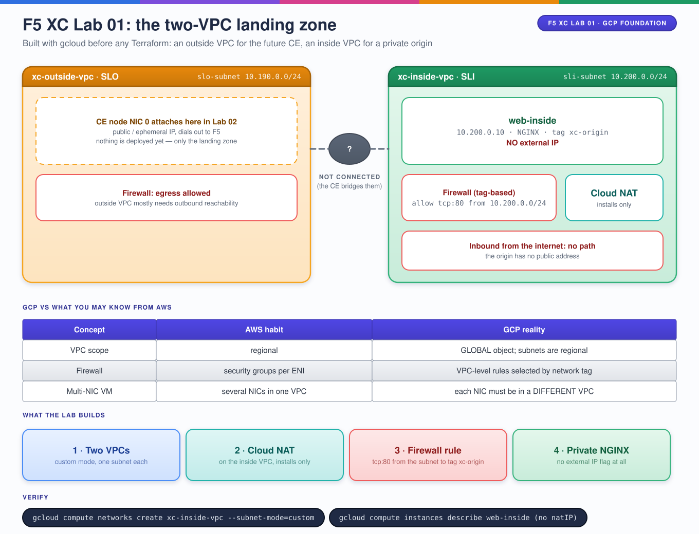
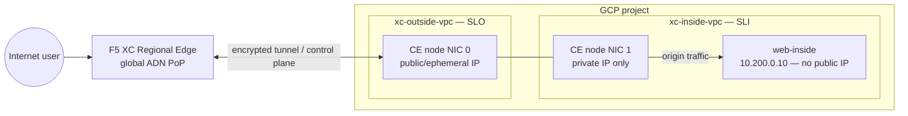

# F5 XC Lab 01 — GCP Networking & F5 Distributed Cloud Site Concepts

This is the first lab in the **F5 Distributed Cloud (XC) track**. Before writing
any code, you need to understand how GCP's network model maps onto F5 XC's edge
architecture — because GCP does networking differently than AWS or Azure.

By the end you will have: two isolated GCP VPCs, a private NGINX web server with
**no public IP**, and a clear mental model of Site Local Outside (SLO) vs Site
Local Inside (SLI).

## Lab contract

| Item | This lab |
|:-----|:---------|
| **Execution model** | Standalone foundation built with `gcloud` / Console (no Terraform yet) |
| **Starts from** | A billing-enabled GCP project; the concepts from the [Terraform & GCP track](../../terraform/01-setup-first-apply/index.md) help but are not required |
| **Creates** | `xc-outside-vpc`, `xc-inside-vpc`, one regional subnet each, firewall rules, Cloud NAT, and one private NGINX VM |
| **Keep after completion** | Yes; Labs 02–04 attach the F5 XC Customer Edge to these VPCs |
| **Next** | [Lab 02 — Manual CE Deployment](../02-manual-ce-deployment/index.md) |

## Resource summary

| Resource | Count | Purpose |
|:---------|------:|:--------|
| `xc-outside-vpc` + `slo-subnet` | 1 | Public-facing VPC that will host the CE node's **SLO** interface |
| `xc-inside-vpc` + `sli-subnet` | 1 | Private VPC that hosts workloads and the CE node's **SLI** interface |
| `web-inside` (Compute Engine VM) | 1 | NGINX origin with **no external IP** — reachable only through F5 XC |
| Firewall rules (both VPCs) | 2 | Tag-based ingress policy on the inside VPC; egress on the outside VPC |
| Cloud Router + Cloud NAT | 1 | Gives `web-inside` outbound internet for package installs only |

## The architecture you are building toward



Editable source: [f5-lab01-landing-zone.drawio](diagrams/f5-lab01-landing-zone.drawio)




The F5 XC **Customer Edge (CE)** is a software node (a Compute Engine VM in this
track) that bridges the F5 XC global network into your VPC. Users connect to an
F5 XC **Regional Edge (RE)** — never to your VM directly — and the CE carries
the traffic from the RE to your private workload.

## Concept map — GCP vs what you may know from AWS

| AWS model | GCP model |
|---|---|
| VPC is a **regional** object | VPC is a **global** object — one VPC spans every region |
| Subnets are tied to an AZ | Subnets are tied to a **region** |
| Security groups attach to instance ENIs | **Firewall rules** attach to the VPC and select targets by **network tag** or **service account** |
| IGW + route table for egress | Egress is implicit if the VM has an external IP; otherwise Cloud NAT |

!!! note "Why two separate VPCs?"
    A GCP VM can have **at most one network interface per VPC**. Because the CE
    node needs one foot in the public world (SLO) and one foot in your private
    workload network (SLI), the standard pattern is **two VPCs** — not two
    subnets in one VPC. This is the GCP equivalent of an appliance with a WAN
    NIC and a LAN NIC.

## SLO vs SLI — the core F5 XC interface model

| Interface | Sits on | Talks to | Public IP? |
|:----------|:--------|:---------|:-----------|
| **SLO** — Site Local Outside | `xc-outside-vpc` | F5 XC SaaS control plane, Regional Edges, the internet | Yes (ephemeral is fine) |
| **SLI** — Site Local Inside | `xc-inside-vpc` | Your Compute Engine / GKE workloads | No — never |

A two-interface CE is called an **ingress/egress gateway** site. Traffic enters
from an RE on the SLO side and exits toward origins on the SLI side. Your
backend VMs keep **zero public exposure** — the only thing that can reach them
is the CE's inside interface.

## GCP service accounts & IAM for F5 XC

F5 XC needs permission inside your project in two places:

1. **Site deployment** — when XC provisions CE VMs itself (Labs 03–04), it uses
   a GCP **service account JSON key** that you upload to the XC Console as
   *Cloud Credentials*. Least privilege means a dedicated SA with Compute Admin
   scoped to the project, not your user account.
2. **VM identity** — the CE VM itself runs as a service account so GCP firewall
   rules can match it by identity instead of IP range.

!!! warning "Key hygiene"
    Service account JSON keys are credentials. Keep them out of git, and prefer
    creating a dedicated `xc-deployer` SA rather than reusing a personal one.

## Hands-on exercise — build the two-VPC foundation

Do this once in the Console or with `gcloud` so you feel each object. Labs 03–04
will express the same thing in Terraform.

```bash
# Set your project once
gcloud config set project YOUR_PROJECT_ID
REGION=us-central1

# 1. Two custom-mode VPCs (global objects)
gcloud compute networks create xc-outside-vpc --subnet-mode=custom
gcloud compute networks create xc-inside-vpc  --subnet-mode=custom

# 2. One regional subnet in each
gcloud compute networks subnets create slo-subnet \
  --network=xc-outside-vpc --region=$REGION --range=10.190.0.0/24

gcloud compute networks subnets create sli-subnet \
  --network=xc-inside-vpc --region=$REGION --range=10.200.0.0/24

# 3. Cloud NAT on the inside VPC so the private VM can install packages
gcloud compute routers create xc-inside-router \
  --network=xc-inside-vpc --region=$REGION
gcloud compute routers nats create xc-inside-nat \
  --router=xc-inside-router --region=$REGION \
  --auto-allocate-nat-external-ips --nat-all-subnet-ip-ranges

# 4. Firewall: allow HTTP to tagged origins ONLY from the inside subnet
gcloud compute firewall-rules create xc-inside-allow-http \
  --network=xc-inside-vpc --direction=INGRESS --action=ALLOW \
  --rules=tcp:80 --target-tags=xc-origin --source-ranges=10.200.0.0/24

# 5. The private NGINX origin — note: NO --address / external IP flag
gcloud compute instances create web-inside \
  --zone=${REGION}-a --machine-type=e2-micro \
  --subnet=sli-subnet --no-address --tags=xc-origin \
  --image-family=debian-12 --image-project=debian-cloud \
  --metadata=startup-script='#!/bin/bash
    apt-get update && apt-get install -y nginx
    echo "<h1>Hello from private web-inside</h1>" > /var/www/html/index.html'
```

## Verify

```bash
# The VM must have no external IP — this is the whole point of the design
gcloud compute instances describe web-inside --zone=${REGION}-a \
  --format='value(networkInterfaces[0].accessConfigs)'

# Prove NAT works (installs succeed) but inbound does not
gcloud compute ssh web-inside --zone=${REGION}-a --tunnel-through-iap \
  --command="curl -s localhost"
```

- `accessConfigs` should be **empty** — no NAT config means no public IP.
- `curl localhost` returns your `<h1>` page via IAP SSH tunnel — the VM is
  alive, serving, and completely unreachable from the internet.

## What to notice

1. **No external IP, yet it installed nginx.** Cloud NAT solves egress without
   giving the VM an inbound presence — same idea as [Terraform Lab 03](../../terraform/03-routing-nat-firewall/index.md).
2. **The firewall rule selects by tag, not subnet.** `--target-tags=xc-origin`
   plus `--source-ranges=10.200.0.0/24` means *any* VM on the inside VPC —
   including the future CE's SLI NIC — can reach origins on port 80, and nothing
   else can.
3. **Two VPCs, zero connectivity between them.** Right now nothing can route
   from `xc-outside-vpc` to `xc-inside-vpc`. Lab 02 plugs the CE into both.
4. **`--no-address`** is the GCP way to say "private workload." Keep this habit —
   the F5 XC value proposition only matters if backends stay dark.

## Checklist before lab 02

- [ ] `xc-outside-vpc` and `xc-inside-vpc` exist, each with one `us-central1` subnet
- [ ] `web-inside` serves NGINX and has **no** external IP
- [ ] You can explain which interface (SLO or SLI) the CE uses to reach `web-inside`, and why
- [ ] You know why GCP needs two VPCs instead of two subnets for a dual-homed appliance

**Next:** [Lab 02 — Manual CE Deployment in the F5 XC Console](../02-manual-ce-deployment/index.md)
