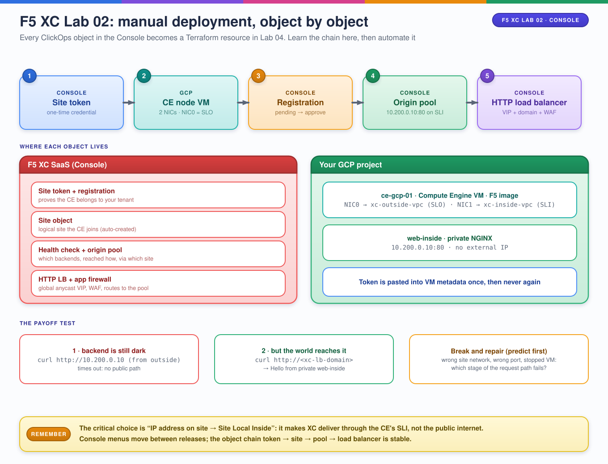
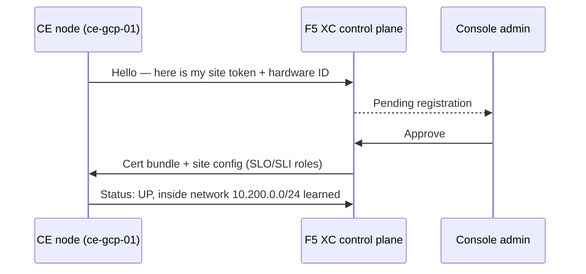
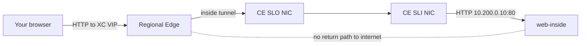

# F5 XC Lab 02 — Manual Deployment in the F5 XC Console

In [Lab 01](../01-gcp-networking-site-concepts/index.md) you built the two-VPC
landing zone and a private NGINX origin. Now you walk the **manual** deployment
path in the F5 XC Console so that when Terraform automates it in Labs 03–04, you
know exactly what the code is doing.

## Lab contract

| Item | This lab |
|:-----|:---------|
| **Execution model** | ClickOps in the F5 XC Console + one GCP Compute Engine VM |
| **Starts from** | Lab 01 VPCs and `web-inside` running; an F5 XC tenant (a free trial works) |
| **Creates** | Site token, one registered CE node, origin pool, health check, HTTP load balancer with WAF |
| **Ends with** | `web-inside` reachable in your browser via an F5 XC load balancer URL |
| **Next** | [Lab 03 — Terraform Dual-Provider Setup](../03-terraform-dual-provider/index.md) |

## Object summary

| F5 XC / GCP object | Count | Purpose |
|:-------------------|------:|:--------|
| Site token | 1 | One-time credential a CE node presents to join a site |
| `ce-gcp-01` (Compute Engine VM, 2 NICs) | 1 | The Customer Edge node itself |
| XC **Site** object (auto-registered) | 1 | Logical site the CE joins |
| Origin pool | 1 | "These backends, on this site, on the inside network" |
| Health check | 1 | TCP/HTTP liveness gating traffic to the origin |
| HTTP load balancer + app firewall | 1 | Global anycast VIP + WAF in front of the pool |

## Object chain at a glance



Editable source: [f5-lab02-manual-deploy.drawio](diagrams/f5-lab02-manual-deploy.drawio)

## 1. Generate a site token

The **site token** is how a new CE node proves it belongs to your tenant.

In the F5 XC Console:

1. Switch to the **Multi-Cloud Network Connect** service.
2. Go to **Manage → Site Management → Site Tokens**.
3. **Add Site Token**, name it `gcp-lab-token`, and copy the generated value —
   you paste it into the CE VM once, then never again.

!!! note "Console navigation moves"
    F5 renames Console paths periodically. If a menu item isn't where this lab
    says, search the Console's object list for *Site Tokens* or *Registrations*
    — the concepts are stable even when the menus shift.

## 2. Deploy the CE node on GCP

The CE is a Compute Engine VM running F5's certified image with **two network
interfaces** — NIC 0 must be the outside (SLO) network because XC assigns SLO to
the first interface.

In **GCP Console → Compute Engine → Create instance** (or Marketplace → *F5
Distributed Cloud Customer Edge*):

| Setting | Value | Why |
|:--------|:------|:----|
| Name | `ce-gcp-01` | Becomes the node name in XC |
| Machine type | `e2-standard-4` (4 vCPU / 16 GB) | CE minimum for a lab; prod uses `n1-standard-4`+ |
| Boot image | F5 XC certified CE image | Contains the Volterra CE software |
| NIC 0 | `slo-subnet` (`xc-outside-vpc`), **ephemeral external IP** | SLO — control plane + RE tunnels |
| NIC 1 | `sli-subnet` (`xc-inside-vpc`), no external IP | SLI — reaches `web-inside` |
| Metadata → `ssh-keys` | Your public key | Emergency console access |

Then inject the token. The CE reads its registration token from **instance
metadata** — the exact key name is shown on the Console's GCP site-deployment
page (it is passed alongside the token when XC generates a deploy bundle). Add
it as a metadata entry on the VM, or use the Console's *"Deploy on GCP"* guided
flow, which hands you either a copy-pasteable `gcloud`/`terraform` command or a
pre-wired marketplace launch — pick the path your Console version offers, the
result is the same VM.

## 3. Watch registration and approve the node

1. After ~2–3 minutes, go to **Site Management → Registrations**.
2. Your node appears as **pending**. Approve it — this is a deliberate
   control-plane step so a stolen token alone can't silently join a site.
3. In **Sites**, confirm the new site reports **healthy** with SLO *and* SLI
   interfaces both `UP`.



## 4. Build the origin pool

The origin pool answers: *"which backends, reachable how, through which site?"*

**Multi-Cloud Network Connect → Manage → Load Balancers → Origin Pools → Add:**

| Field | Value |
|:------|:------|
| Name | `web-inside-pool` |
| Origin server → type | **IP address on site** |
| IP | `10.200.0.10` |
| Site | your GCP site, network = **Site Local Inside** |
| Port | `80` |

The critical choice is **"on site → inside network"** — that tells XC to deliver
traffic through the CE's SLI interface, not over the public internet.

Attach a simple **health check** (`tcp` on 80, or `http` GET `/`) so the pool
goes dark instead of black-holing if the VM dies.

## 5. Publish with an HTTP load balancer + WAF

**Manage → Load Balancers → HTTP Load Balancers → Add:**

| Field | Value |
|:------|:------|
| Name / domain | `web-gcp` → XC gives you an auto-generated `*.ves.app`-style domain |
| Advertise | **Public** (on Regional Edges worldwide) |
| Origin pool | `web-inside-pool` |
| Web Application Firewall | Enable — the default app firewall is fine for the lab |
| HTTPS | Optional lab shortcut: HTTP-only first, add certs later |

## Verify — the payoff moment

```bash
# 1. Backend is still dark
gcloud compute instances describe web-inside --zone=us-central1-a \
  --format='value(networkInterfaces[0].accessConfigs)'   # → empty

# 2. But the world can reach it through F5 XC
curl -v http://YOUR-LB-DOMAIN/
# → <h1>Hello from private web-inside</h1>
```



## What to notice

1. **The backend never had a public IP** — yet it serves global traffic. The RE
   terminates client connections; the CE carries them inward.
2. **Registration required human approval.** Control-plane trust is explicit.
3. **The origin pool's "inside network" flag is the whole trick** — without it,
   XC would try to reach `10.200.0.10` from the public side and fail.
4. **WAF ran before any Terraform.** Keep that ordering in mind: Lab 04 turns
   this same WAF into a `volterra_app_firewall` resource.

## Break and repair (predict first)

- Stop `web-inside`. Predict: health check fails → pool unhealthy → LB returns
  503/No healthy upstream, **not** a timeout. Verify, restart, re-verify.
- Remove the `xc-origin` tag from the VM. Predict which layer breaks and where
  you'd see it in GCP firewall logs vs XC monitoring.

## Checklist before lab 03

- [ ] Site shows healthy with both SLO and SLI `UP`
- [ ] `curl` to the LB domain returns your NGINX page
- [ ] You can explain the full path: browser → RE → SLO → SLI → `10.200.0.10`
- [ ] You can name the three console objects Terraform will own (site, origin pool, HTTP LB + WAF)

**Next:** [Lab 03 — Setting Up Terraform for GCP & F5 XC](../03-terraform-dual-provider/index.md)
