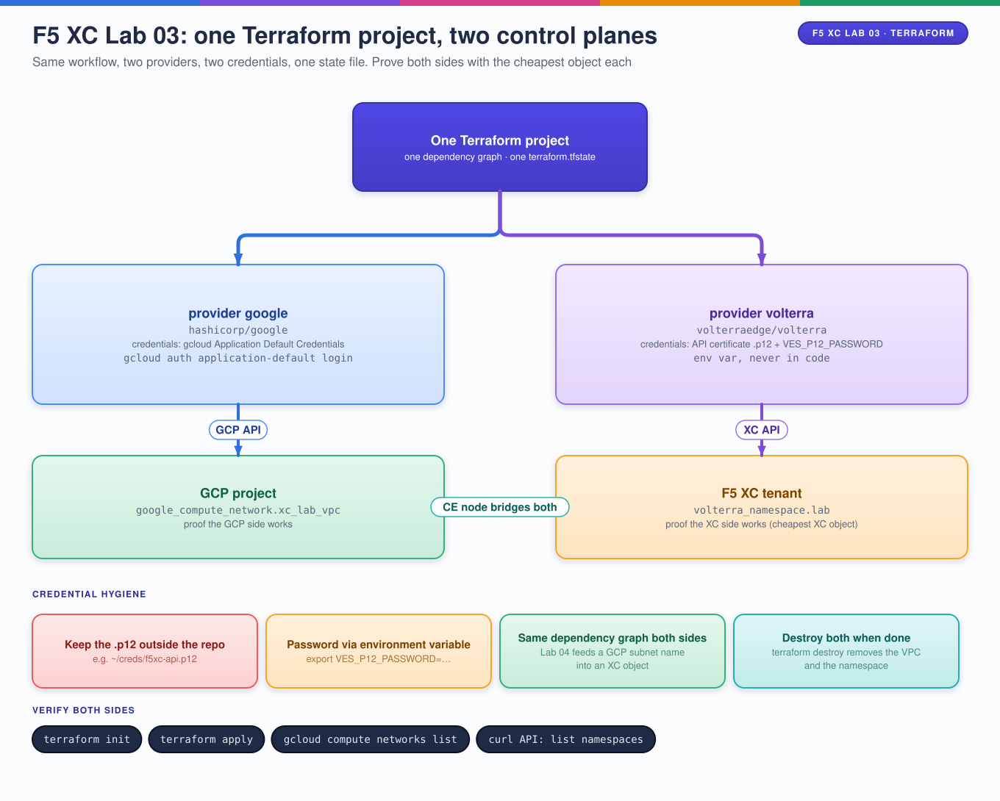
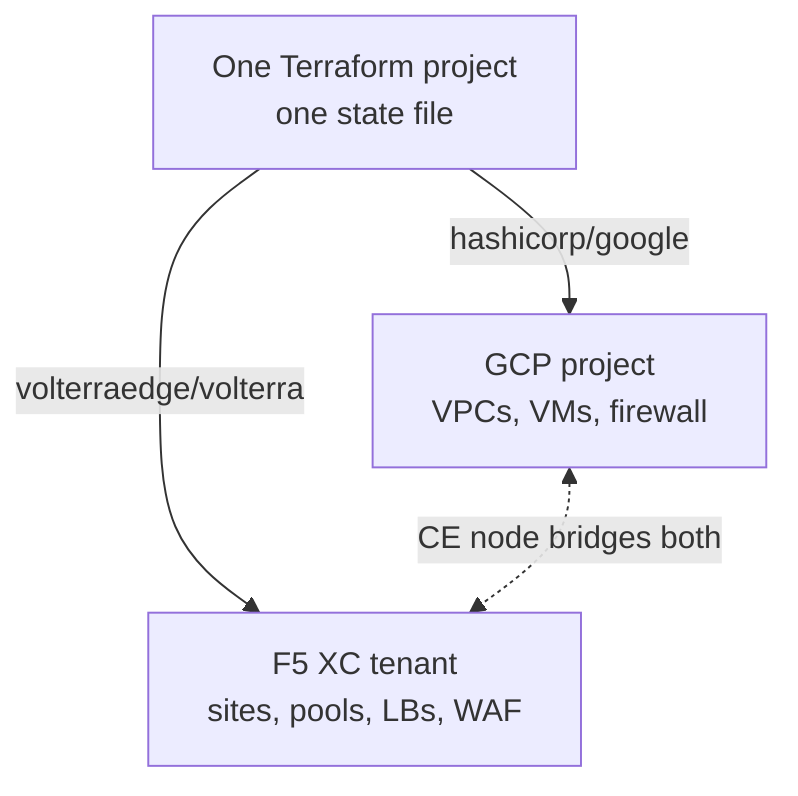

# F5 XC Lab 03 — Setting Up Terraform for GCP & F5 XC

Labs 01–02 proved the architecture works. This lab prepares your local
environment to manage **two control planes from one Terraform project**: GCP
infrastructure through the `google` provider, and F5 XC SaaS objects through
the `volterra` provider.

## Lab contract

| Item | This lab |
|:-----|:---------|
| **Execution model** | Standalone Terraform config — smallest possible dual-provider proof |
| **Starts from** | Terraform + `gcloud` installed (Terraform Lab 01 pattern), an F5 XC tenant |
| **Creates** | One GCP VPC *and* one F5 XC namespace in a single `apply` |
| **Ends with** | Credentials working for both providers; destroy the two resources |
| **Next** | [Lab 04 — Automated Site, Discovery & WAF](../04-automated-site-waf/index.md) |

## Resource summary

| Terraform block | Count | Purpose |
|:----------------|------:|:--------|
| `provider google` | 1 | Manages GCP resources via Application Default Credentials |
| `provider volterra` | 1 | Manages F5 XC objects via a `.p12` API certificate |
| `google_compute_network.xc_lab_vpc` | 1 | Proof the GCP side works |
| `volterra_namespace.lab` | 1 | Proof the XC side works — a namespace is the cheapest XC object |

## Two providers, one state file



Editable source: [f5-lab03-dual-provider.drawio](diagrams/f5-lab03-dual-provider.drawio)




Each provider talks to its own API with its own credentials. Terraform doesn't
care that they are different clouds — the dependency graph can even reference
one side from the other (Lab 04 feeds a GCP subnet name into an XC site object).

## 1. GCP credentials — same as the Terraform track

```bash
gcloud auth application-default login
gcloud config set project YOUR_PROJECT_ID
```

The `google` provider picks up Application Default Credentials automatically.

## 2. F5 XC credentials — the `.p12` API certificate

In the F5 XC Console:

1. **Administration → Personal Management → Credentials → Add Credentials**.
2. Type: **API Certificate**. Download the `.p12` file and set a password.
3. Store it outside the repo — e.g. `~/creds/f5xc-api.p12`.

```bash
# The provider reads the cert password from an env var, never from code
export VES_P12_PASSWORD='YOUR_CERT_PASSWORD'
```

!!! warning "Credential boundaries"
    The `.p12` file, its password, and any GCP service-account JSON key are all
    secrets. None of them belong in `*.tf`, in `.tfvars` committed to git, or in
    screenshots. Lab 03 uses env vars for this reason.

## 3. `main.tf` — the dual-provider block

```hcl
terraform {
  required_version = ">= 1.5.0"

  required_providers {
    google = {
      source  = "hashicorp/google"
      version = "~> 5.0"          # same line as the rest of this track
    }
    volterra = {
      source  = "volterraedge/volterra"
      version = "~> 0.13"         # vetted release line; check registry for newer
    }
  }
}

provider "google" {
  project = var.project_id
  region  = var.region
}

provider "volterra" {
  api_p12_file = var.f5xc_p12_path
  url          = "https://${var.f5xc_tenant}.console.ves.volterra.io/api"
}

variable "project_id" {
  description = "GCP project ID to deploy into"
  type        = string
}

variable "region" {
  type    = string
  default = "us-central1"
}

variable "f5xc_tenant" {
  description = "F5 XC tenant short name (the part before .console.ves.volterra.io)"
  type        = string
}

variable "f5xc_p12_path" {
  description = "Absolute path to the downloaded .p12 API certificate"
  type        = string
  default     = "~/creds/f5xc-api.p12"
}

# ---- GCP side: one VPC, like Lab 01's landing zone ----
resource "google_compute_network" "xc_lab_vpc" {
  name                    = "xc-tf-proof-vpc"
  auto_create_subnetworks = false
}

# ---- XC side: a namespace to hold future objects ----
resource "volterra_namespace" "lab" {
  name = "netlab"
}
```

!!! note "Where did the agenda's `~> 6.0` go?"
    The roadmap's starter block suggests `google ~> 6.0`; this track pins
    `~> 5.0` to stay consistent with the earlier Terraform labs. Either works —
    provider pinning is a repo convention, not an F5 requirement. What matters
    is that `volterra` and `google` can coexist in `required_providers`.

!!! note "Namespaces are XC's folders"
    Almost every XC object lives in a `namespace` (`system`, `shared`, or one
    you create). The provider default is often `system`; real configs put apps
    in their own namespace, exactly like Kubernetes.

## Apply & verify both sides

```bash
terraform init          # downloads BOTH providers — watch it happen
terraform plan -var="project_id=YOUR_PROJECT_ID" -var="f5xc_tenant=YOUR_TENANT"
terraform apply -var="project_id=YOUR_PROJECT_ID" -var="f5xc_tenant=YOUR_TENANT"
```

Prove each side independently:

```bash
# GCP side
gcloud compute networks list --filter='name=xc-tf-proof-vpc'

# XC side — the namespace appears in the Console's namespace picker,
# or via the XC API:
curl -sk --cert-type P12 --cert ~/creds/f5xc-api.p12:$VES_P12_PASSWORD \
  https://YOUR_TENANT.console.ves.volterra.io/api/web/namespaces | grep netlab
```

## What to notice

1. **`terraform init` fetched two providers.** Open `.terraform.lock.hcl` —
   both `hashicorp/google` and `volterraedge/volterra` are pinned there.
2. **One apply, two APIs.** Terraform created the VPC and the namespace in the
   same run; there was no cross-dependency so it may have done them in parallel.
3. **The `volterra` provider wraps XC's REST API.** Everything you clicked in
   Lab 02 — sites, tokens, pools, load balancers — is a resource type.
4. **`url` is your tenant's API endpoint**, not GCP's. The provider talks to
   `*.console.ves.volterra.io`, the same API the Console UI uses.

## Exercise

Add a second resource to each side so the file manages four objects:

```hcl
resource "google_compute_network" "xc_lab_inside" {
  name                    = "xc-tf-proof-inside"
  auto_create_subnetworks = false
}
```

Then run `terraform plan` and predict the action count before reading the
output. (Answer: 2 to add, 0 to change, 0 to destroy.)

## Cleanup

```bash
terraform destroy -var="project_id=YOUR_PROJECT_ID" -var="f5xc_tenant=YOUR_TENANT"
unset VES_P12_PASSWORD   # when fully done for the session
```

## Checklist before lab 04

- [ ] `terraform init` succeeds with both providers
- [ ] One `apply` created a GCP VPC **and** an XC namespace
- [ ] `.p12` + `VES_P12_PASSWORD` auth works — you verified via API or Console
- [ ] You can name which provider owns: the CE VM image, the site token, the origin pool, the GCP subnet

**Next:** [Lab 04 — Automating End-to-End GCP Sites & Security](../04-automated-site-waf/index.md)
