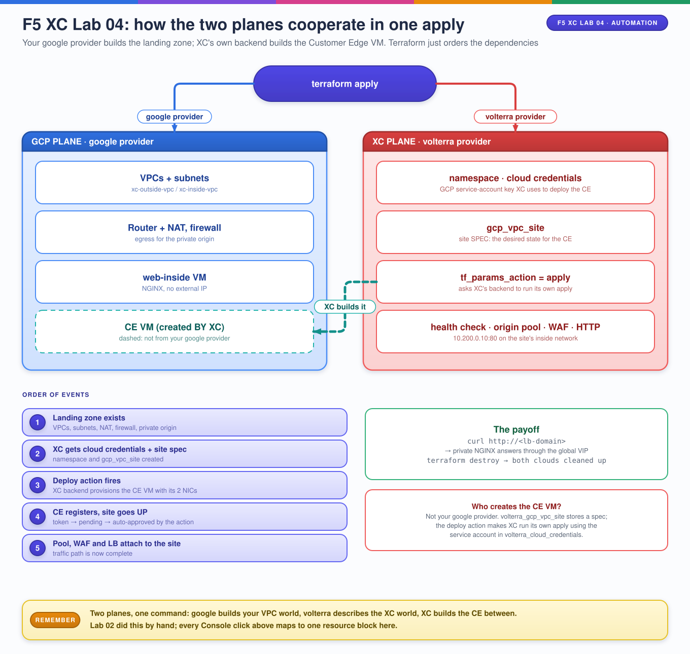
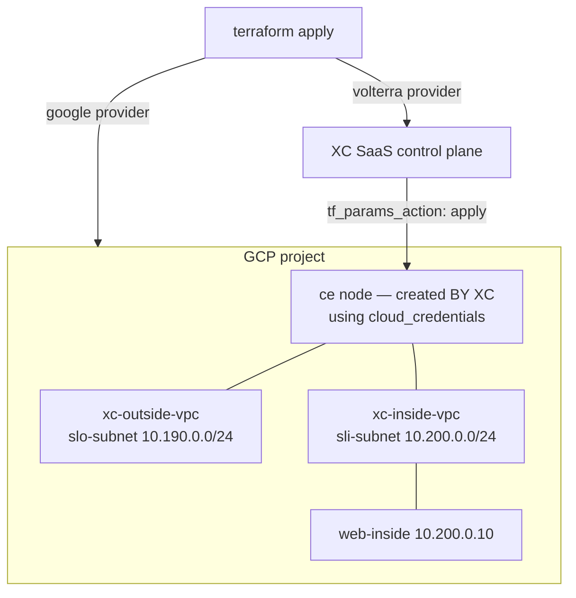

# F5 XC Lab 04 — Automating End-to-End GCP Sites & Security

Capstone of the F5 XC track. One `terraform apply` builds the **entire** Lab
01–02 architecture: both VPCs, the private NGINX origin, the Customer Edge site,
the origin pool, the WAF, and the global HTTP load balancer — across two cloud
control planes.

## Lab contract

| Item | This lab |
|:-----|:---------|
| **Execution model** | Standalone capstone; single Terraform root module, dual providers |
| **Starts from** | Lab 03 credentials working (`.p12` + `VES_P12_PASSWORD`, `gcloud` ADC) plus a GCP service-account key for XC cloud credentials |
| **Creates** | 2 VPCs, subnets, NAT, firewall, private VM + XC cloud credentials, `gcp_vpc_site`, deploy action, health check, origin pool, app firewall, HTTP LB |
| **Ends with** | `curl` the LB domain → private NGINX; `terraform destroy` removes both clouds' resources |
| **Previous** | [Lab 03 — Terraform Dual-Provider Setup](../03-terraform-dual-provider/index.md) |

## Resource summary

| Terraform block | Count | Plane | Purpose |
|:----------------|------:|:------|:--------|
| `google_compute_network` ×2, `google_compute_subnetwork` ×2 | 4 | GCP | SLO and SLI VPCs/subnets |
| `google_compute_router` + `google_compute_router_nat` | 2 | GCP | Egress for the private origin |
| `google_compute_firewall` | 1 | GCP | Tag-based HTTP allow on the inside VPC |
| `google_compute_instance.web_inside` | 1 | GCP | NGINX origin, no external IP |
| `volterra_namespace.netlab` | 1 | XC | Namespace for app objects |
| `volterra_cloud_credentials.gcp` | 1 | XC | GCP SA key XC uses to deploy the CE VM |
| `volterra_gcp_vpc_site.gcp` | 1 | XC | Site **object** — the desired-state spec for the CE |
| `volterra_tf_params_action.apply` | 1 | XC | Triggers XC's own apply that creates the CE VM in GCP |
| `volterra_healthcheck.http` | 1 | XC | HTTP liveness on the origin |
| `volterra_origin_pool.web` | 1 | XC | `10.200.0.10:80` on the site's inside network |
| `volterra_app_firewall.waf` | 1 | XC | Blocking-mode WAF policy |
| `volterra_http_loadbalancer.web` | 1 | XC | Public VIP + domain + WAF + route to the pool |

## How the two planes cooperate



Editable source: [f5-lab04-two-planes.drawio](diagrams/f5-lab04-two-planes.drawio)




!!! important "Who creates the CE VM?"
    **Not your `google` provider.** `volterra_gcp_vpc_site` creates a site
    *spec* in XC; `volterra_tf_params_action` then asks XC's backend to run its
    own apply, which provisions the Compute Engine VM using the GCP service
    account in `volterra_cloud_credentials`. This mirrors what the Console did
    for you in Lab 02.

## 1. Providers & variables

```hcl
terraform {
  required_version = ">= 1.5.0"

  required_providers {
    google = {
      source  = "hashicorp/google"
      version = "~> 5.0"
    }
    volterra = {
      source  = "volterraedge/volterra"
      version = "~> 0.13"
    }
  }
}

provider "google" {
  project = var.project_id
  region  = var.region
}

provider "volterra" {
  api_p12_file = var.f5xc_p12_path
  url          = "https://${var.f5xc_tenant}.console.ves.volterra.io/api"
}

variable "project_id"    { type = string }
variable "region"        { type = string  default = "us-central1" }
variable "f5xc_tenant"   { type = string }
variable "f5xc_p12_path" { type = string  default = "~/creds/f5xc-api.p12" }

variable "gcp_sa_key_path" {
  description = "Path to a GCP service-account JSON key that XC uses to deploy the CE"
  type        = string
  sensitive   = true
}

variable "lb_domain" {
  description = "Hostname served by the XC load balancer (see DNS note below)"
  type        = string
}

variable "ssh_public_key" {
  description = "SSH key injected onto the CE node"
  type        = string
}
```

## 2. GCP side — the landing zone, as code this time

```hcl
resource "google_compute_network" "outside" {
  name                    = "xc-outside-vpc"
  auto_create_subnetworks = false
}

resource "google_compute_network" "inside" {
  name                    = "xc-inside-vpc"
  auto_create_subnetworks = false
}

resource "google_compute_subnetwork" "slo" {
  name          = "slo-subnet"
  ip_cidr_range = "10.190.0.0/24"
  region        = var.region
  network       = google_compute_network.outside.id
}

resource "google_compute_subnetwork" "sli" {
  name          = "sli-subnet"
  ip_cidr_range = "10.200.0.0/24"
  region        = var.region
  network       = google_compute_network.inside.id
}

resource "google_compute_router" "inside" {
  name    = "xc-inside-router"
  network = google_compute_network.inside.name
  region  = var.region
}

resource "google_compute_router_nat" "inside" {
  name                               = "xc-inside-nat"
  router                             = google_compute_router.inside.name
  region                             = var.region
  nat_ip_allocate_option             = "AUTO_ONLY"
  source_subnetwork_ip_ranges_to_nat = "ALL_SUBNETWORKS_ALL_IP_RANGES"
}

resource "google_compute_firewall" "inside_http" {
  name    = "xc-inside-allow-http"
  network = google_compute_network.inside.id

  source_ranges = ["10.200.0.0/24"]
  target_tags   = ["xc-origin"]

  allow {
    protocol = "tcp"
    ports    = ["80"]
  }
}

resource "google_compute_instance" "web_inside" {
  name         = "web-inside"
  machine_type = "e2-micro"
  zone         = "${var.region}-a"
  tags         = ["xc-origin"]

  boot_disk {
    initialize_params {
      image = "debian-cloud/debian-12"
    }
  }

  # private only — deliberately no access_config block
  network_interface {
    subnetwork = google_compute_subnetwork.sli.id
    network_ip = "10.200.0.10"
  }

  metadata_startup_script = <<-EOS
    #!/bin/bash
    apt-get update && apt-get install -y nginx
    echo "<h1>Hello from private web-inside</h1>" > /var/www/html/index.html
  EOS
}
```

## 3. XC side — credentials, site spec, and the deploy action

```hcl
resource "volterra_namespace" "netlab" {
  name = "netlab"
}

# GCP service-account key XC will use to create the CE VM
resource "volterra_cloud_credentials" "gcp" {
  name      = "gcp-lab-creds"
  namespace = "system"

  gcp_cred_file {
    credential_file {
      clear_secret_info {
        url = "string:///${base64encode(file(var.gcp_sa_key_path))}"
      }
    }
  }
}

resource "volterra_gcp_vpc_site" "gcp" {
  name           = "gcp-xc-lab"
  namespace      = "system"
  gcp_region     = var.region
  instance_type  = "n1-standard-4"
  ssh_key        = var.ssh_public_key

  cloud_credentials {
    name      = volterra_cloud_credentials.gcp.name
    namespace = "system"
    tenant    = var.f5xc_tenant
  }

  default_blocked_services = true
  logs_streaming_disabled  = true
  private_connect_disabled = true

  # Two-interface site = SLO + SLI, matching Lab 02 exactly
  ingress_egress_gw {
    gcp_certified_hw = "gcp-byol-voltmesh"
    gcp_zone_names   = ["${var.region}-a"]
    node_number      = 1

    outside_network {
      existing_network {
        name = google_compute_network.outside.name
      }
    }
    outside_subnet {
      existing_subnet {
        subnet_name = google_compute_subnetwork.slo.name
      }
    }
    inside_network {
      existing_network {
        name = google_compute_network.inside.name
      }
    }
    inside_subnet {
      existing_subnet {
        subnet_name = google_compute_subnetwork.sli.name
      }
    }

    no_network_policy        = true
    no_inside_static_routes  = true
    no_outside_static_routes = true
    no_global_network        = true
    sm_connection_public_ip  = true

    performance_enhancement_mode {
      perf_mode_l7_enhanced {
        jumbo_disabled = true
      }
    }
  }
}

# XC's backend runs its own apply that creates the CE Compute Engine VM
resource "volterra_tf_params_action" "deploy" {
  site_name       = volterra_gcp_vpc_site.gcp.name
  site_kind       = "gcp_vpc_site"
  action          = "apply"
  wait_for_action = true
}
```

!!! note "Module alternative"
    The agenda suggests `terraform-google-modules/network/google` for the VPCs —
    it works identically; the site object only needs the resulting *names*.
    Raw resources are used here to keep every CIDR visible on one page.
    For fleet deployments see F5's published GCP CE modules on the Volterra
    registry/GitHub — they wrap `volterra_gcp_vpc_site` + `tf_params_action`.

## 4. XC side — health check, origin pool, WAF, load balancer

```hcl
resource "volterra_healthcheck" "http" {
  name                = "web-http-hc"
  namespace           = volterra_namespace.netlab.name
  healthy_threshold   = 1
  interval            = 15
  timeout             = 3
  unhealthy_threshold = 2

  http_health_check {
    path                   = "/"
    use_origin_server_name = true
  }
}

resource "volterra_origin_pool" "web" {
  name                   = "web-inside-pool"
  namespace              = volterra_namespace.netlab.name
  endpoint_selection     = "LOCAL_PREFERRED"
  loadbalancer_algorithm = "LB_OVERRIDE"
  port                   = 80
  no_tls                 = true
  same_as_endpoint_port  = true

  origin_servers {
    private_ip {
      ip             = "10.200.0.10"
      inside_network = true
      site_locator {
        site {
          name      = volterra_gcp_vpc_site.gcp.name
          namespace = "system"
          tenant    = var.f5xc_tenant
        }
      }
    }
  }

  healthcheck {
    name      = volterra_healthcheck.http.name
    namespace = volterra_healthcheck.http.namespace
    tenant    = var.f5xc_tenant
  }
}

resource "volterra_app_firewall" "waf" {
  name      = "lab-waf"
  namespace = volterra_namespace.netlab.name

  allow_all_response_codes   = true
  default_anonymization      = true
  use_default_blocking_page  = true
  default_bot_setting        = true
  default_detection_settings = true
  blocking                   = true
  disable_ai_enhancements    = true
}

resource "volterra_http_loadbalancer" "web" {
  name      = "web-gcp"
  namespace = volterra_namespace.netlab.name
  domains   = [var.lb_domain]

  advertise_on_public_default_vip = true
  disable_api_definition          = true
  disable_api_discovery           = true
  disable_api_testing             = true
  no_challenge                    = true
  round_robin                     = true
  disable_malicious_user_detection = true
  disable_malware_protection      = true
  disable_rate_limit              = true
  default_sensitive_data_policy   = true
  no_service_policies             = true
  disable_threat_mesh             = true
  disable_trust_client_ip_headers = true
  user_id_client_ip               = true

  http {
    port_ranges = "80"
  }

  app_firewall {
    name      = volterra_app_firewall.waf.name
    namespace = volterra_app_firewall.waf.namespace
  }

  default_route_pools {
    pool {
      name      = volterra_origin_pool.web.name
      namespace = volterra_origin_pool.web.namespace
    }
  }
}
```

!!! note "About `var.lb_domain`"
    XC must be able to answer for the hostname: either a domain delegated to XC
    (Console → DNS Management → delegated domain, then `dns_volterra_managed`
    can create the record for you), or any hostname you control where you add a
    CNAME pointing at the VIP hostname shown in the LB's status after apply.

## Apply & verify

```bash
export VES_P12_PASSWORD='YOUR_CERT_PASSWORD'

terraform init
terraform apply \
  -var="project_id=YOUR_PROJECT_ID" \
  -var="f5xc_tenant=YOUR_TENANT" \
  -var="gcp_sa_key_path=$HOME/creds/xc-deployer.json" \
  -var="lb_domain=web.your-delegated-domain.com" \
  -var="ssh_public_key="$(cat ~/.ssh/id_ed25519.pub)""
```

Watch the order in the plan graph — Terraform must finish the GCP subnets
before XC deploys the CE into them, and `tf_params_action` may take 10–15
minutes while XC provisions and registers the node.

```bash
# CE node exists in GCP (created by XC, not by your google provider)
gcloud compute instances list --filter='name~gcp-xc-lab'

# Private origin serves through the global VIP
curl -v http://web.your-delegated-domain.com/
```

## What to notice

1. **Cross-plane references just work.** `volterra_gcp_vpc_site` consumes
   `google_compute_subnetwork.slo.name` — Terraform sequences the clouds
   automatically because of the reference graph.
2. **XC's provider is declarative twice.** Your state holds the site *object*;
   `tf_params_action` makes XC materialize it into real GCP VMs. `wait_for_action`
   means `apply` doesn't return until the CE is up.
3. **The WAF travels with the code.** Review, diff, and roll back security
   policy like any other resource — the same `volterra_app_firewall` block can
   be reused across sites via a module.
4. **Service discovery is the natural extension.** `volterra_discovery`
   (with `discovery_gcp` + the same cloud credentials) lets XC inventory Compute
   Engine instances by label/tag so pools can track discovered endpoints instead
   of a hardcoded `10.200.0.10` — combine it with the `xc-origin` tag from Lab 01
   and GKE services for the fully dynamic version of this lab.

## Break and repair (predict first)

- Remove `same_as_endpoint_port` — predict where the health check lands.
- Change `inside_network = true` to `outside_network = true` in the pool —
  which layer fails, and does the LB go 503 or timeout?

## Cleanup

```bash
terraform destroy -var-file=...   # same -var flags as apply
unset VES_P12_PASSWORD
```

`tf_params_action` destroys the CE VM on the XC side as part of site deletion;
the GCP networks and VM leave with the rest of the state.

## Track completion checklist

- [ ] One `terraform apply` produced a working global LB → private origin path
- [ ] You can explain why the CE VM does **not** appear in `*.tf` as a `google_compute_instance`
- [ ] You can locate every secret path (`.p12`, SA key, env vars) and confirm none are in code
- [ ] You know which resource to change to switch the site from lab (1 node, 1 zone) to prod (3 nodes, 3 zones)
