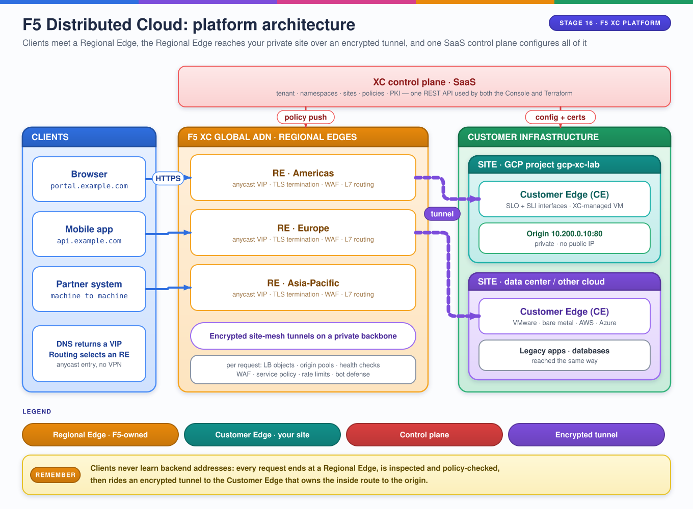

# Stage 17: F5 Distributed Cloud Platform Architecture

> **Key takeaways:** F5 Distributed Cloud (XC) is a SaaS-delivered application
> delivery network. A central **control plane** manages two kinds of
> **data plane** edges: F5-owned **Regional Edges (REs)** that terminate client
> traffic, and your **Customer Edges (CEs)** that reach private workloads.
> Every object is API-defined, which is why the same platform is configurable
> by Console and Terraform.

## The problem it solves

Publishing a private application to the internet classically requires some
combination of public IPs on backends, a DMZ, your own WAF, DNS/global load
balancing, and CDN contracts. Each is a different system with a different
policy model.

XC collapses this into one claim: **keep backends dark; terminate clients on
our edges; carry traffic to your site over an encrypted mesh.** The platform
provides the anycast entry points, the tunnel fabric, the WAF, and the
observability — you provide a CE node inside each network that hosts origins.

## The two planes

| Plane | Runs where | Does what |
|---|---|---|
| **Control plane** | F5's SaaS (your *tenant*) | Stores every object's desired state, issues certificates, pushes config, collects logs and metrics, approves site registrations |
| **Data plane** | RE PoPs + your CEs | Terminates TLS, inspects requests, load balances, tunnels traffic to origins |

The separation matters operationally: a CE keeps forwarding with cached config
if the control plane is briefly unreachable, and no traffic ever *terminates*
at the control plane — it is policy and identity only.

## Building blocks

| Object | One-line meaning | Analog in earlier stages |
|---|---|---|
| Tenant | Your organization boundary in the SaaS | AWS account / GCP org |
| Namespace | Object grouping + RBAC scope | Kubernetes namespace / GCP project |
| **Site** | A logical location made of CE nodes | A VPC + edge router pair |
| **RE** | F5-operated edge that clients connect to | CloudFront/Cloudflare PoP |
| **CE** | Your edge — a VM/appliance in your network | A dual-homed router + tunnel endpoint |
| Origin pool | Named set of backends + how to reach them | Backend service / target group |
| Health check | Liveness probe gating pool membership | GCP health check |
| HTTP/TCP LB | VIP + domain + routes + policy + pools | L7 load balancer + WAF rules |
| App firewall | The WAF policy attached to an LB | Cloud Armor / AWS WAF policy |
| Service policy | L3/L4+L7 allow/deny lists on an LB | Firewall rule scoped to a listener |

## RE vs CE — the distinction everything hangs on

| Property | Regional Edge (RE) | Customer Edge (CE) |
|---|---|---|
| Owned/operated by | F5 | You (XC-managed software) |
| Runs on | F5's global PoP network | Your GCP project, DC, other cloud |
| Faces | Clients (anycast VIPs) | Your workloads (private IPs) |
| Role | Terminate, inspect, route | Connect site inward, forward to origins |

!!! note "CE ≠ proxy exposed to the internet"
    The CE initiates outbound tunnels *to* REs; it does not need inbound ports
    open from the internet. This inverts the usual edge appliance model and is
    why a CE fits inside a private VPC design.

## Identity and isolation: tenant + namespace

Almost every XC object lives in a **namespace** (`system`, `shared`, or one you
create). Site-level infrastructure (sites, cloud credentials, CEs) lives in
`system`; application objects (pools, LBs, WAFs) go in workload namespaces so
teams can be scoped independently — the same mental model as Kubernetes RBAC.

## API-first, and why that matters for Terraform

The Console is a client of the same REST API the
[volterraedge/volterra provider](https://registry.terraform.io/providers/volterraedge/volterra/latest/docs)
calls. There is no "click-only" path: every object in the tables above is a
Terraform resource. Authentication is a `.p12` API certificate scoped to your
tenant — one credential covers the whole SaaS side, while GCP resources still
use their own provider credentials. Lab 03 wires exactly that dual-provider
setup.

## What XC is not

- **Not a VPN replacement for clients.** Users get no network-layer access;
  only applications you publish through LBs are reachable.
- **Not a cloud of its own.** It carries traffic *between* your sites and
  clients; your workloads stay in GCP/AWS/on-prem.
- **Not a packet-forwarding router inside your VPC.** The CE is a managed
  appliance for XC delivery, not a replacement for Cloud Router/NAT design.

## Map it to the labs

| Concept here | Proven in |
|---|---|
| CE bridging two network zones | [Lab 01 — SLO/SLI concepts](../f5-xc/01-gcp-networking-site-concepts/index.md) |
| Site token + registration + pools + LB | [Lab 02 — manual deployment](../f5-xc/02-manual-ce-deployment/index.md) |
| API-first → Terraform resources | [Lab 03 — dual providers](../f5-xc/03-terraform-dual-provider/index.md) |
| Whole platform as code | [Lab 04 — automated site + WAF](../f5-xc/04-automated-site-waf/index.md) |
