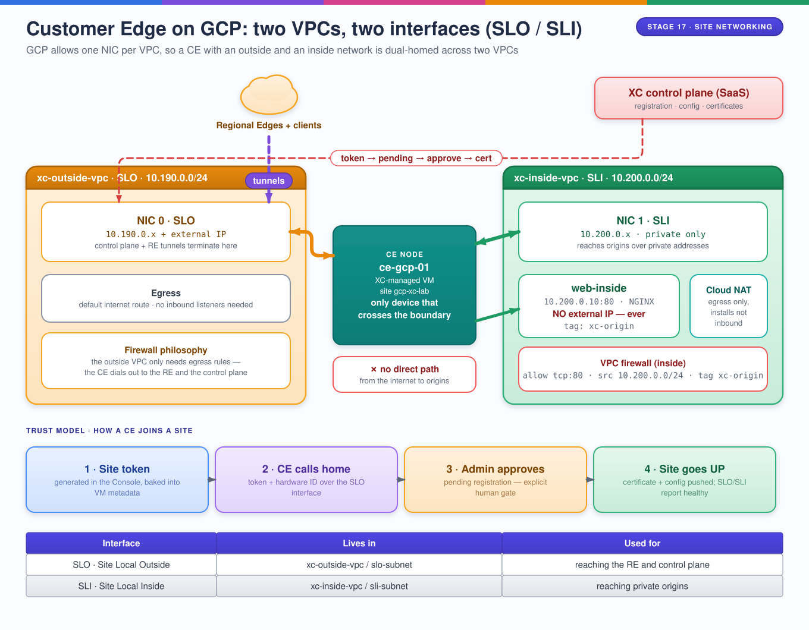

# Stage 18: F5 XC Site Networking on GCP

> **Key takeaways:** A *site* is the unit that connects your infrastructure to
> XC. On GCP, the standard shape is a two-interface CE: **SLO** on an outside
> VPC for control plane and edge tunnels, **SLI** on an inside VPC for origins.
> GCP's one-NIC-per-VPC rule is why the design uses two VPCs instead of two
> subnets.

## What a "site" is

In XC, a site is a **logical location** — a name that groups one or three CE
nodes, their interfaces, and their site-local networks. Origin pools, LBs, and
discovery all reference *the site*, not the VM — so the CE can be replaced or
scaled without touching application config.

## Site types

| Type | NICs | Use when |
|---|---:|---|
| **Ingress gateway** | 1 | Only inbound delivery is needed and inside/outside share one subnet (small sites, App Stack) |
| **Ingress/egress gateway** | 2 | The classic dual-homed design — inbound delivery **and** outbound controls (this track's pattern) |
| **Secure mesh node** | 1–2 | Site-to-site connectivity between your sites over the XC backbone, no client-facing LB |
| **App Stack (voltstack) cluster** | 1+ | CE also runs a managed K8s and deploys workloads directly |

The two-interface ingress/egress mode is what gives the SLO/SLI split its
meaning: SLO is a *zone*, not just an interface — it is where control-plane and
RE-facing traffic is allowed to exist.

## SLO vs SLI in GCP terms

| | SLO — Site Local Outside | SLI — Site Local Inside |
|---|---|---|
| Purpose | Control plane, RE tunnels, internet egress | Reach origins and site-local services |
| GCP VPC | `xc-outside-vpc` (`slo-subnet`) | `xc-inside-vpc` (`sli-subnet`) |
| External IP | Yes — ephemeral is fine | Never |
| Firewall posture | Outbound-friendly; inbound managed by CE itself | Tight: only what origins need |
| Lab addressing | `10.190.0.0/24` | `10.200.0.0/24` |

## Why two VPCs — the GCP constraint

GCP assigns **at most one network interface per VPC** to a VM. A dual-homed
appliance therefore cannot be "two subnets in one VPC"; it needs two VPCs. This
has two useful consequences:

1. The inside VPC stays a clean security boundary — no route, no external IP,
   no internet-facing listener exists on the workload side by default.
2. GCP firewall rules can treat the two zones differently: the inside rule in
   the labs allows `tcp:80` from `10.200.0.0/24` to tag `xc-origin`, which
   covers the CE's SLI address and nothing else.

!!! note "Compare with earlier stages"
    The CE is structurally the dual-homed router of
    [Stage 4](04-switches-routers.md) — it forwards across a boundary that has
    no other path — except the "routing" is policy-driven tunneling to REs
    rather than destination-prefix forwarding, and the management plane lives
    in SaaS.

## The registration trust model

A CE is not trusted because it has an IP — it is trusted through a staged
handshake:

1. **Site token** — generated in the Console (or as a Terraform object),
   delivered to the VM through instance metadata.
2. **Registration request** — the CE presents token + hardware identity over
   SLO to the control plane.
3. **Approval** — an admin accepts the pending registration. A stolen token
   alone cannot silently join a site.
4. **Issued identity** — the node gets a certificate and becomes a known,
   revocable endpoint; all later tunnels use node certs, not the token.

## Deployment paths — three ways to the same node

| Path | How the CE VM is created | When to use |
|---|---|---|
| Console manual (Lab 02) | You launch the F5 marketplace image with 2 NICs + token metadata | Learning, demos, one-offs |
| XC-orchestrated Terraform (Lab 04) | `volterra_gcp_vpc_site` + `volterra_tf_params_action` — XC runs *its own* apply using your `volterra_cloud_credentials` GCP service account | Repeatable, auditable infra |
| Custom automation | BYO Compute Engine with the certified image + registration metadata | Integrating with existing instance pipelines |

Notice that in the Terraform path, **your `google` provider never creates the
CE VM** — GCP shows the instance, but the resource lives in XC's plane. That
distinction decides where you look when the node fails to come up.

## IAM and credentials map

| Credential | Held by | Grants |
|---|---|---|
| `.p12` API certificate | You / CI | Manage XC objects for the tenant |
| GCP SA key in `volterra_cloud_credentials` | XC control plane | Create/modify Compute Engine VMs in your project |
| CE's own GCP service account | The CE VM | GCP API identity + firewall matching by SA |
| Site token | CE VM at boot | One-time registration into a named site |

## Failure modes worth memorizing

| Symptom | Most likely layer |
|---|---|
| Node never appears in Registrations | SLO egress blocked, bad metadata/token |
| Registration pending forever | Human approval step — by design |
| Site UP but pools unreachable | Origin pool pointed at outside network, or inside VPC firewall missing |
| CE can't reach origins | SLI NIC on wrong VPC, or firewall tag mismatch |
| CE created but site shows errors | XC's SA lacks Compute permissions in your project |

## Map it to the labs

[Lab 01](../f5-xc/01-gcp-networking-site-concepts/index.md) builds this exact
topology by hand; [Lab 02](../f5-xc/02-manual-ce-deployment/index.md) walks the
registration path in the Console; [Lab 04](../f5-xc/04-automated-site-waf/index.md)
turns the whole site into `volterra_gcp_vpc_site` code.
