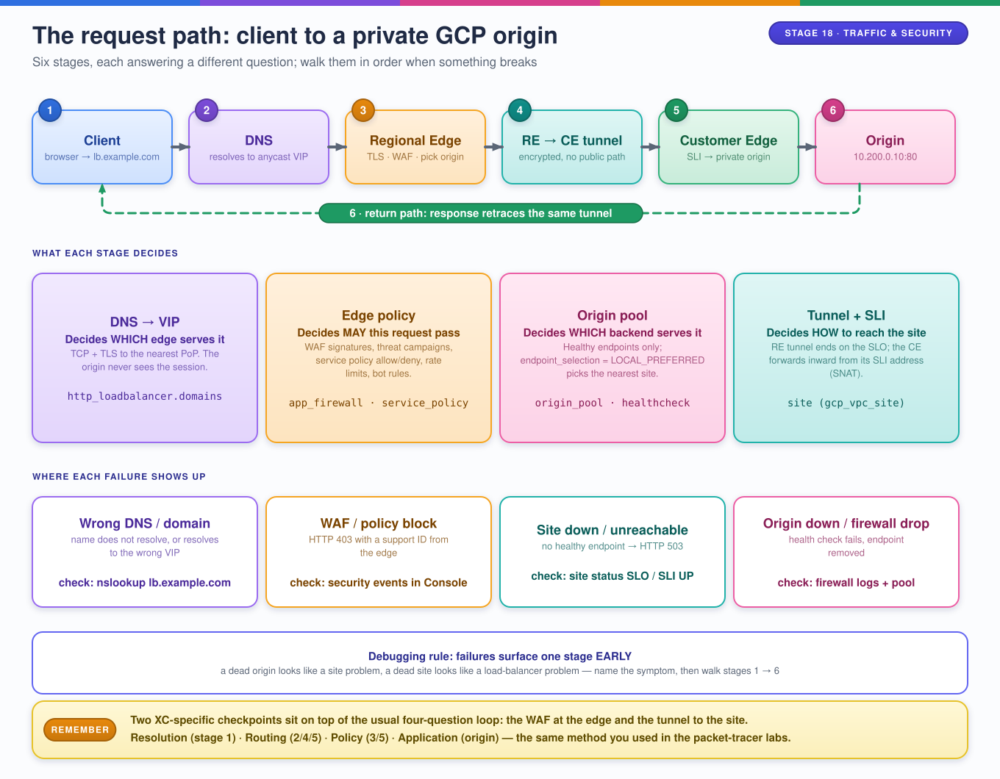

# Stage 19: F5 XC Origins, Load Balancing & Security

> **Key takeaways:** In XC the *origin pool* owns "where backends are and how
> to reach them," the *health check* owns "who is allowed to serve," the
> *HTTP load balancer* owns "which clients reach which pools and under what
> policy," and the *app firewall* is the WAF attached to the LB. A request
> survives six decisions between DNS and the private origin.

## Origin pool — the routing contract

An origin pool answers three questions:

| Question | Field (Terraform shape) | Lab value |
|---|---|---|
| Who are the backends? | `origin_servers` → `private_ip` / `k8s_service` / `public_ip` / discovered endpoint | `10.200.0.10` |
| Reached how? | `inside_network` / `outside_network` + `site_locator` | inside, site `gcp-xc-lab` |
| On what port & policy? | `port`, `no_tls`/`use_tls`, `endpoint_selection`, `loadbalancer_algorithm` | 80, `LOCAL_PREFERRED`, `LB_OVERRIDE` |

The **`inside_network` flag is the security-relevant line** — it means "deliver
through the CE's SLI interface." Pointing at `outside_network` sends the REs'
traffic down the public side, which is usually both wrong and unreachable.

`endpoint_selection` controls whether only the local site's endpoints serve
(`LOCAL_ONLY`), local is preferred with remote failover (`LOCAL_PREFERRED`), or
any site may serve (`DISTRIBUTED`).

## Health checks

Independent objects referenced by pools. An HTTP check (`GET /`) verifies the
application; a TCP check verifies the listener. Pools only send traffic to
healthy endpoints — a dead origin produces `503`/no-healthy-upstream responses
at the RE **before** any client bytes reach your site. Match the check to what
"healthy" means: a TCP check passes on a crashed-but-listening app; HTTP 200 on
`/` is stronger.

## HTTP load balancer — anatomy

| Concern | Field(s) | Notes |
|---|---|---|
| Hostname | `domains[]` | Must be DNS-answerable: delegated to XC or CNAME'd to the LB's VIP hostname |
| Exposure | `advertise_on_public_default_vip` / custom VIP / `do_not_advertise` | Public VIP = reachable at every RE; `do_not_advertise` for internal testing |
| Routing | `default_route_pools` (or `routes` for path/host rules) | The pool(s) requests fall through to |
| Transport | `http` / `https` / `https_auto_cert` | Auto-cert needs XC-managed DNS to complete ACME |
| Stickiness/algo | `round_robin` / `least_active` / `source_ip_stickiness` … | Per-LB choice |
| Policy | `app_firewall` ref, `service_policies`, `rate_limit`, `*_challenge` | The security stack attached at the edge |

A newer provider quirk worth knowing: many "feature off" choices
(`disable_api_discovery`, `no_challenge`, `disable_rate_limit`, …) are
**required one-of groups** — you must explicitly pick off/on rather than
leaving them unset. That is why Lab 04's LB block lists so many `disable_*`
lines.

## The security stack — three enforcement layers

| Layer | Object | Evaluates | Typical lab use |
|---|---|---|---|
| Edge WAF | `volterra_app_firewall` | Signatures, threat campaigns, bot classes, attack types — returns a block page with support ID | `blocking` mode with default detection |
| Service policy | `volterra_service_policy` | L7 allow/deny rules (path, method, headers, geo, ASN, IP reputation) | Deny `/admin`, allow-list partners |
| Site network policy | `active_network_policies` / enhanced firewall on the site | L3/L4 rules inside the site fabric | Restrict what the CE may reach SLI-side |

WAF modes: `monitoring` (log only), `blocking` (log + block). Start a new app
in `blocking` only if you accept false-positive tuning work; `monitoring`
first is the safer rollout for real apps.

## Where each failure shows up

| Symptom | Stage | First check |
|---|---|---|
| Domain won't resolve | 1 | `domains[]` value, delegated DNS/CNAME |
| TLS/cert errors | 2 | `https_auto_cert` vs delegated DNS, or BYO cert |
| 403 + support ID | 3 | Security event log; WAF mode/signatures |
| 503 no healthy upstream | 4/5 | Site SLO/SLI UP? health check passing? |
| Timeouts to origin | 5 | GCP firewall rule, inside/outside flag on pool |
| Right page, wrong client IP in logs | — | `enable_trust_client_ip_headers` + app reads `X-Forwarded-For` |

!!! tip "Same four questions, two new checkpoints"
    The learning-path loop — Resolution · Routing · Policy · Application —
    still applies. XC adds two policy checkpoints: the **edge WAF** (stage 3)
    and the **tunnel/site health** (stage 4). Symptoms name the layer:
    403-support-ID is policy, 503-no-upstream is reachability.

## Map it to the labs

- [Lab 02](../f5-xc/02-manual-ce-deployment/index.md) clicks through pool → LB → WAF in the Console.
- [Lab 04](../f5-xc/04-automated-site-waf/index.md) encodes all of it: `volterra_healthcheck`, `volterra_origin_pool`, `volterra_app_firewall`, `volterra_http_loadbalancer`.
- Extend with `volterra_discovery` to let GCP labels/GKE services populate endpoints dynamically, and `volterra_service_policy` for allow/deny rules beyond the WAF.
