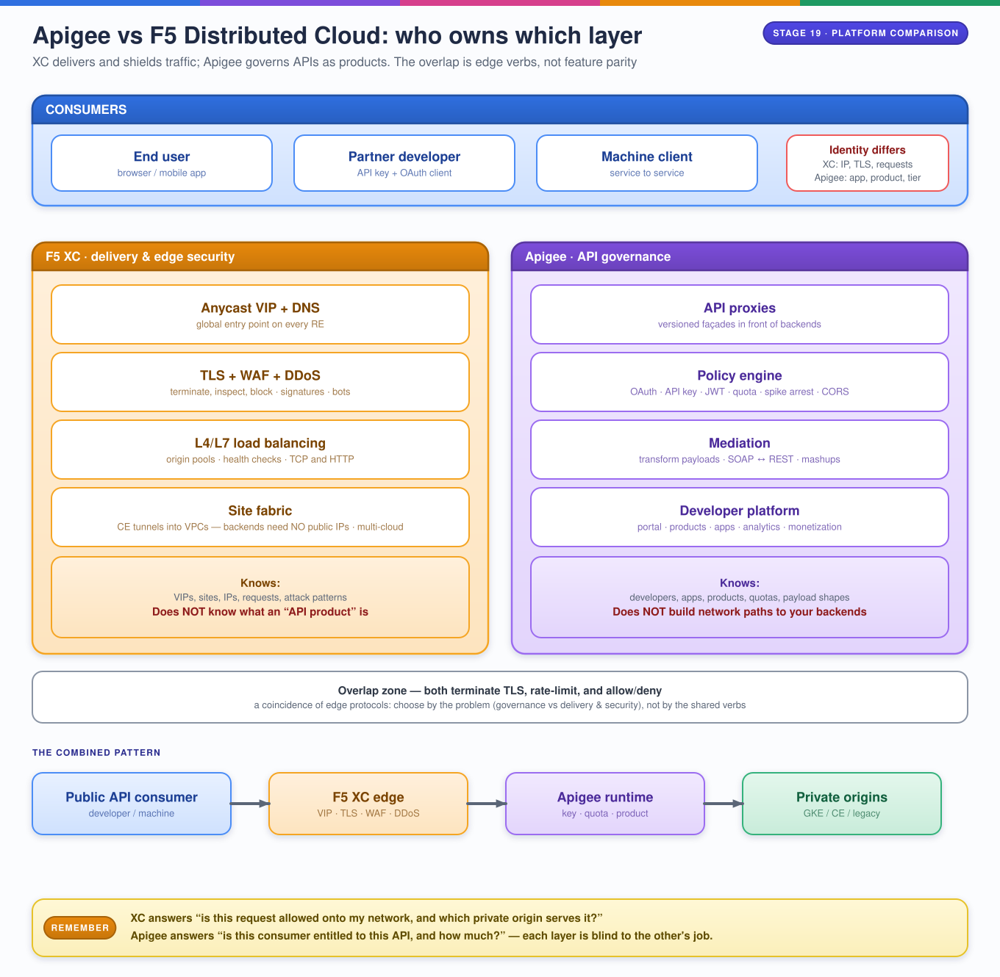
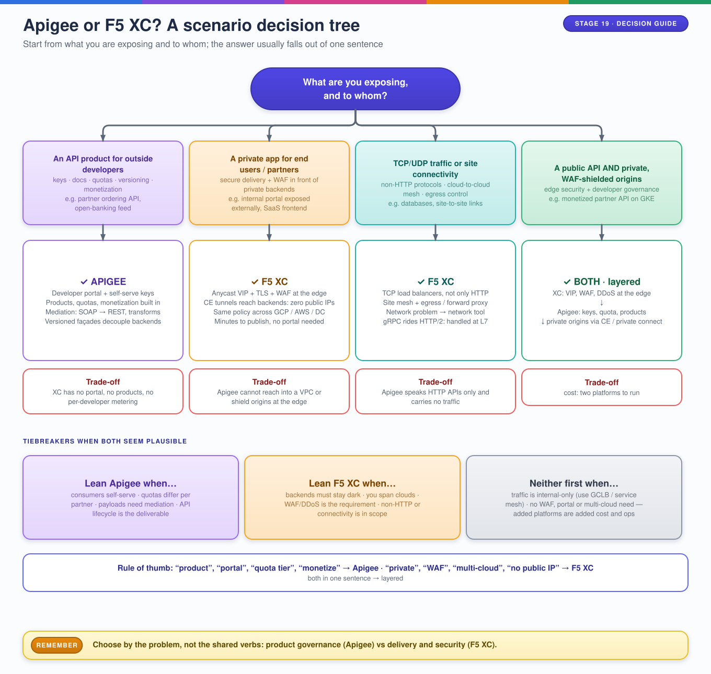

# Apigee vs F5 Distributed Cloud — Choosing the Right Front Door

> **Key takeaways:** Apigee governs *APIs as products* — developer identity,
> quotas, mediation, portals. F5 XC delivers *traffic to private backends* —
> anycast entry, WAF, tunnels, multi-cloud load balancing. They share an HTTPS
> edge but solve different problems. Use Apigee when the consumer is a
> developer, F5 XC when the problem is the network and perimeter, and both
> when a governed API product must sit behind an edge WAF with private
> origins.

Both platforms appeared in earlier material: Apigee as the private API entry
point in the [GKE case study](16-terraform-gke-case-study.md), and F5 XC across
stages [17](17-f5-xc-platform-architecture.md)–[19](19-f5-xc-traffic-security.md).
This page is the bridge: same front-door position, different jobs.

## Same surface, different questions

| Question your design asks | Owner |
|---|---|
| Which developer/app may call this API, how much, under which product? | **Apigee** |
| Is this request malicious, and which private origin may serve it? | **F5 XC** |
| How do backends with no public IP become reachable? | **F5 XC** |
| How do consumers discover APIs and get keys without asking you? | **Apigee** |
| How do GCP, AWS, and a data center share one policy fabric? | **F5 XC** |
| How does a SOAP backend answer a REST consumer? | **Apigee** |

## What each actually is

**Apigee** — an *API management* platform. API proxies are versioned façades;
policies verify OAuth/JWT/API keys, enforce quota and spike arrest, transform
payloads (SOAP↔REST, XML↔JSON), and a developer portal lets consumers
self-serve docs and keys. Products, apps, analytics, and monetization make APIs
a managed offering. Identity is the **developer and the app**.

**F5 XC** — an *edge delivery and security* fabric. Regional Edges terminate
clients on anycast VIPs, WAF/DDoS inspects requests, load balancers pick origin
pools, and Customer Edges tunnel into your VPCs so backends need **zero public
IPs** — across GCP, AWS, or a data center. Identity is the **site and the
request**.



## Where they overlap — and where they don't

| Capability | Apigee | F5 XC |
|---|:---:|:---:|
| Terminate TLS / HTTPS | ✅ | ✅ |
| Rate limiting / quotas | ✅ per-developer, per-product | ✅ per-source, per-endpoint |
| AuthN on requests | ✅ OAuth, JWT, API key | ✅ JWT/mTLS on LB (lighter) |
| WAF (signatures, bots, campaigns) | ⚠️ basic threat policies only | ✅ core strength |
| Load balance across sites/clouds | ❌ | ✅ |
| Reach private backends with no public IP | ⚠️ only via peering/private connect you build | ✅ CE tunnel is the product |
| Non-HTTP (TCP) traffic | ❌ | ✅ |
| Developer portal / API products / monetization | ✅ | ❌ |
| Payload mediation & transformation | ✅ | ❌ |
| Site-to-site mesh between your clouds | ❌ | ✅ |

The overlap (TLS, rate limit, allow/deny) is a *protocol coincidence*, not
feature parity — Apigee's limits are about entitlement economics, XC's are
about abuse prevention.

## What's good under which scenario

| Scenario | Pick | Why |
|---|---|---|
| Partner developer API with keys, docs, quota tiers | **Apigee** | Portal + products + per-consumer metering are built for exactly this |
| Monetized/open API program | **Apigee** | Monetization and analytics exist nowhere in XC |
| Legacy SOAP service behind a modern REST façade | **Apigee** | Mediation/transform policies are its specialty |
| Private web app for end users, backends must stay dark | **F5 XC** | CE tunnels + anycast VIP + WAF in one product |
| Same security posture across GCP + AWS + DC | **F5 XC** | One control plane, one WAF policy, every site |
| TCP/non-HTTP workload exposure | **F5 XC** | Apigee speaks HTTP APIs only |
| Lift-and-shift needing WAF for PCI/compliance fast | **F5 XC** | Publish + WAF in minutes; no developer portal tax |
| Internal-only microservice traffic | **Neither** | Use GCLB/service mesh — don't buy an edge for east-west |
| Public API product + private origins + edge WAF | **Both** | XC shields and delivers, Apigee governs and meters |



## The combined pattern

When a governed API product needs a security perimeter and private origins,
stack them — XC at the edge, Apigee inside:

```text
consumer → [F5 XC: VIP + TLS + WAF + bot/geo policy]
         → [Apigee: API key + quota + product + mediation]
         → [private origins: GKE / CE / legacy — still zero public IPs]
```

Each layer is blind to the other's job. In the
[case study](16-terraform-gke-case-study.md), Apigee is *privately* exposed and
clients arrive over IPsec VPN — the combined pattern replaces that VPN
requirement with an XC edge for public-facing scenarios while keeping Apigee's
governance.

## Anti-patterns

- **Apigee as the security perimeter.** Threat policies ≠ WAF. Putting Apigee
  directly on the internet as your only defense misses DDoS absorption, attack
  signatures, and bot management.
- **XC load balancer as API management.** No portal, no products, no
  per-developer quotas — you'll rebuild Apigee badly in service policies.
- **XC CE for internal-only traffic.** East-west traffic inside one VPC doesn't
  need a global edge network; it's cost and hops without benefit.
- **Apigee for non-HTTP workloads.** It is an HTTP API platform; databases,
  custom TCP, and site connectivity are out of scope.

## Rule of thumb

> Apigee is bought for the **developer relationship**; F5 XC is bought for the
> **network + security perimeter**. Sentence contains *"product", "portal",
> "quota tier", "monetize"* → Apigee. Contains *"private", "WAF",
> "multi-cloud", "no public IP"* → F5 XC. Both → layered.

## Map it back

- Apigee's private-exposure model: [GKE case study](16-terraform-gke-case-study.md#7-govern-private-api-traffic-with-apigee)
- XC platform & edge roles: [Stage 17](17-f5-xc-platform-architecture.md)
- XC private-origin delivery: [Stage 18](18-f5-xc-site-networking-gcp.md), [Stage 19](19-f5-xc-traffic-security.md)
- Hands-on XC: [F5 XC labs](../f5-xc/01-gcp-networking-site-concepts/index.md)
